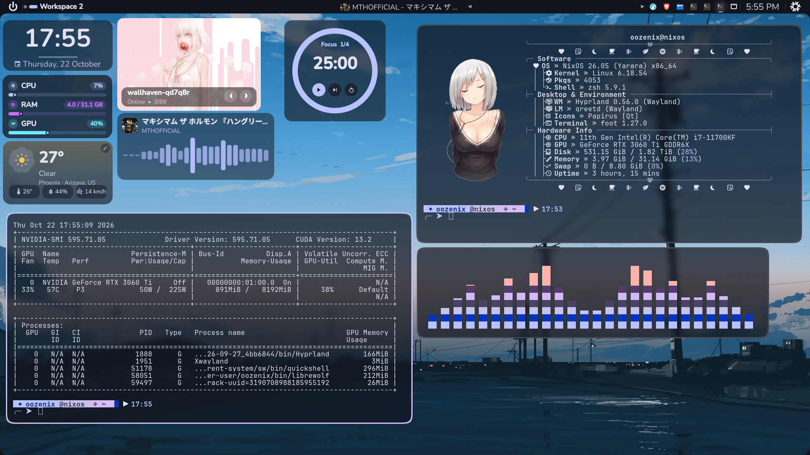
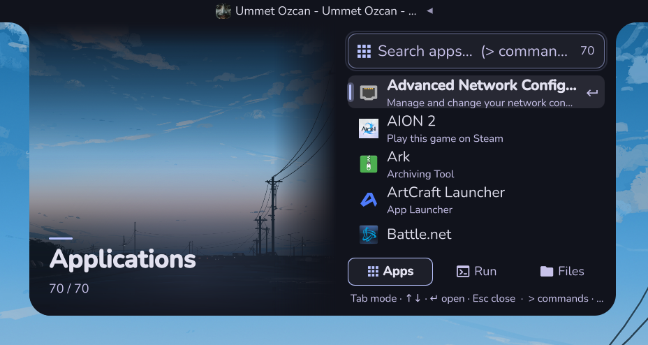
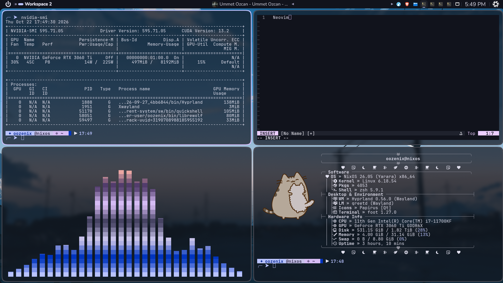
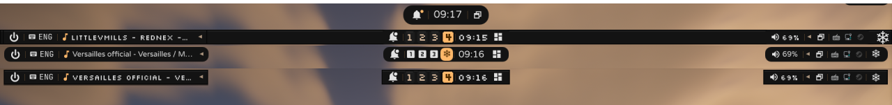
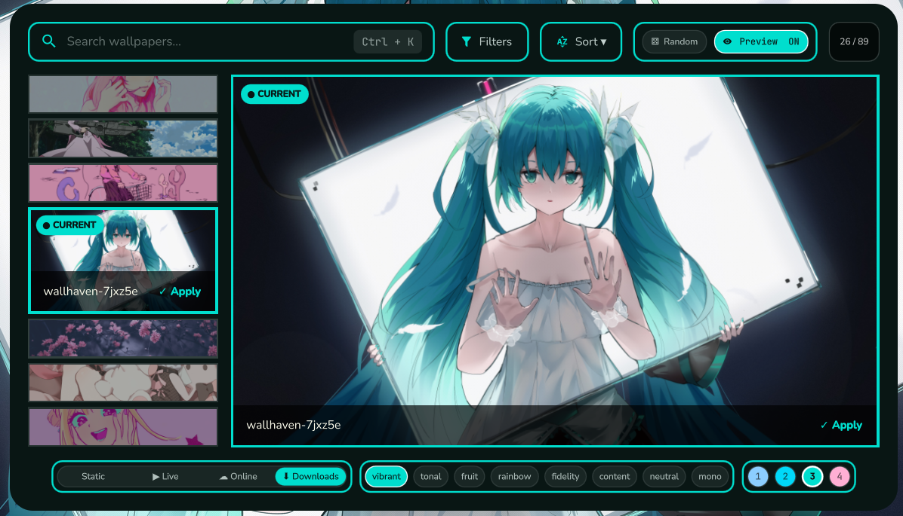
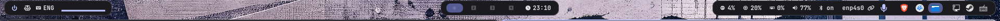
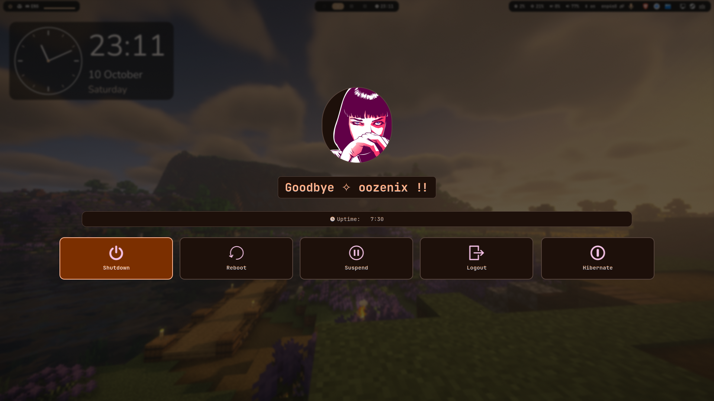

# OozeDots Beta

**OozeDots** es un escritorio listo para usar en Linux con **Hyprland** y **OozeShell**, un shell propio hecho con Quickshell y Qt6: barra, lanzador, notificaciones, bloqueo, selector de fondos, dock y más, en un mismo estilo.

Funciona en **NixOS** (objetivo principal) y **Arch Linux**.



> **Lee esto antes de empezar**
> * Son ajustes personales: tendrás que adaptar monitores, GPU (pensado para **NVIDIA**), teclado y algunas rutas.
> * Requiere **Hyprland 0.55 o superior** (`hyprland.lua`).
> * En NixOS lo más fácil es combinarlo con [nix-home](https://github.com/shizukutakahashi55-del/nix-home).
> * Instalar reemplaza tu configuración actual por enlaces a este repositorio. Se pregunta antes y se guarda respaldo, pero conviene probarlo en una instalación nueva o en otro usuario.

¿Nuevo en Linux? Mira [Primeros pasos](DotDocs/Primeros-pasos.md).

---

## Capturas

| Escritorio | Launcher | Terminal |
| --- | --- | --- |
|  |  |  |

| Barra | Selector de fondos |
| --- | --- |
|  |  |

| Waybar | wlogout |
| --- | --- |
|  |  |

---

## Instalación

Necesitas Arch o NixOS con internet y un usuario normal con `sudo`. El repositorio debe estar en `~/dotfiles`.

```bash
sudo pacman -S --needed git
git clone https://github.com/oozeux/oozedots.git ~/dotfiles
cd ~/dotfiles
chmod +x install-oozedots.sh
./install-oozedots.sh
```

En NixOS usa `nix-shell -p git` en lugar del primer comando.

* Ejecútalo como usuario normal, nunca con `sudo`. Usa `-y` para aceptar todas las respuestas sugeridas.
* Si dudas en una pregunta, ve a [Instalador](DotDocs/Instalador.md).
* Al terminar, cierra sesión y elige **Hyprland**.
* `SUPER+I` muestra los atajos; `SUPER+L` elige monitor; `SUPER+G` el idioma.

Más detalle: [Dependencias](DotDocs/Dependencias.md) · [OozeShell](DotDocs/OozeShell.md) · [Temas y Waybar](DotDocs/Temas-y-Waybar.md) · [Componentes opcionales](DotDocs/Componentes-opcionales.md).

---

## Actualizar

```bash
cd ~/dotfiles
./update-oozedots.sh
```

`./update-oozedots.sh --check` solo informa si hay novedades. Opciones y actualización manual: [Actualización avanzada](DotDocs/Actualizacion-avanzada.md).

---

## Desinstalar

Quitar un enlace simbólico no borra el repositorio. Comprueba a dónde apunta cada uno (`readlink -f ~/.config/hypr`) y luego:

```bash
rm ~/.config/{alacritty,cava,dolphin,fastfetch,foot,ghostty,hypr,kitty,matugen,nvim,quickshell,wezterm,yazi,waybar,rofi,starship.toml} \
   ~/.config/vesktop/themes ~/.zshrc
rm -f ~/.config/{swaync,swayosd,niri,mango} ~/.local/bin/nix-rofi
```

Si instalaste OozeWalls:

```bash
rm -f ~/.local/bin/{oozewalls,oozewalls-gui,oozewalls-live}
rm -rf ~/.local/share/oozewalls
```

Borra solo enlaces que apunten a este repositorio. Los respaldos (`*.bak-<fecha>`) no se tocan; para restaurar uno, renómbralo.

---

## Problemas frecuentes

Primer paso: ejecutar el programa desde una terminal y leer el error.

| Problema | Solución |
| --- | --- |
| `Could not find .../OozeShell.zip` | Pon `OozeShell.zip` en `~/dotfiles` y reejecuta. |
| Se niega a ejecutarse | Úsalo como usuario normal, sin `sudo`. |
| `Permission denied` | `chmod +x install-oozedots.sh` |
| No aparece nada tras iniciar sesión | `quickshell -c OozeShell` en una terminal y lee los errores. |
| Barra o fondo no se ven | `SUPER+L` o `oozeshell monitor set auto`. |
| Iconos o emoji como cuadros | Instala JetBrainsMono Nerd Font, Symbols Nerd Font Mono y `noto-fonts-emoji`. |
| No se listan fondos | `mkdir -p ~/Pictures/Wallpapers` y pon imágenes. |
| Hyprland ignora cambios de apariencia | `hyprctl reload` |

Lista completa: [Problemas](DotDocs/Problemas.md).

---

## Documentación

| Archivo | Contenido |
| --- | --- |
| [Primeros pasos](DotDocs/Primeros-pasos.md) | Glosario, sistemas compatibles, qué revisar. |
| [Instalador](DotDocs/Instalador.md) | Qué hace, preguntas y enlaces. |
| [Dependencias](DotDocs/Dependencias.md) | Paquetes por grupo. |
| [OozeShell](DotDocs/OozeShell.md) | Funciones, atajos e IPC. |
| [Temas y Waybar](DotDocs/Temas-y-Waybar.md) | Matugen, fondos y Waybar. |
| [Componentes opcionales](DotDocs/Componentes-opcionales.md) | Núcleo nativo, OozeWalls, Suwayomi, `git-update`. |
| [Actualización avanzada](DotDocs/Actualizacion-avanzada.md) | Opciones y método manual. |
| [Problemas](DotDocs/Problemas.md) | Soluciones completas. |
| [Estructura](DotDocs/Estructura.md) | Árbol del repositorio. |

---

## Licencia

Archivos de configuración personales. Úsalos, modifícalos y adáptalos como quieras.
